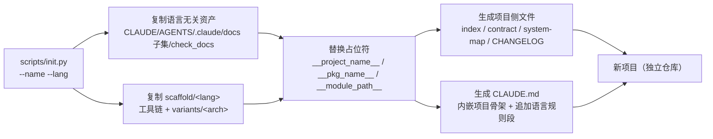

# 系统地图：项目模板

> status: stable · 范围：模板仓库自身的组件与数据流 · 最近核实：2026-11-20 · 入口：`scripts/init.py`、`scripts/check_docs.py`、`scripts/check_scaffold.py`

## 当前流程

实例化数据流（模板 → 新项目）：

组件职责：

- `scripts/init.py` — 生成器：复制、替换、裁剪、组装（唯一写新项目的地方；scaffold 与根资产同名目录合并、同名文件拒绝覆盖）
- `scripts/check_docs.py` — 文档健康：索引登记、死链、ADR 编号、头部标记
- `scripts/check_scaffold.py` — 实编验收：实例化两变体并用真实工具链跑格式 / lint / 测试 / CLI（模板 CI `scaffolds` job 的本机同款）
- `scaffold/<lang>/` — 语言种子：工具链配置（语言根，含项目侧 `.github/workflows/ci.yml`）+ `variants/{cls,hex}/` 分层骨架 + 示例 + 语言 CLAUDE.md 段（实例化按 `--arch` 选其一）
- `scaffold/_shared/` — 语言无关的项目侧初始文件（CHANGELOG）
- `docs/` — 单一事实源（见 ADR-0003）
- `.claude/skills/` — 可复用任务流程

## 关键配置与外部依赖

- 占位符三枚：`__project_name__`（显示名）、`__pkg_name__`（包/构件名）、`__module_path__`（Go module 路径）
- 项目版 CLAUDE.md 骨架内嵌于 `scripts/init.py` 的 `PROJECT_CLAUDE_TEMPLATE`（行为声明见 `docs/reference/init.md`）
- 运行生成器需要 Python 3.11+（stdlib only）

## 失败与维护入口

| 现象 | 应查位置 |
|---|---|
| 实例化产物有 `__...__` 残留 | `scripts/tests/test_init.py` 冒烟（应已拦截）；检查 init.py 替换表 |
| 项目 docs 校验失败 | `python scripts/check_docs.py`（项目内同名脚本） |
| 项目 CLAUDE.md 内容不对（模板专属内容混入或缺语言段） | `scripts/init.py` 的 `PROJECT_CLAUDE_TEMPLATE` 与 `build_claude_md` |
| 新语言脚手架不被冒烟覆盖 | `scripts/tests/test_init.py` 加用例 + `docs/guides/add-language.md` 清单 |

## 已确认 / 推断 / 未知

- 已确认：目录结构与脚本行为以当前代码为准；`check_scaffold.py` 四语言 × 两变体本机全过（2026-11-20）。
- 待验证：GitHub runner 上 `scaffolds` job 首跑（命令与本机同款，环境差异理论上为零）。
- 推断：无。

## 可选改进

- CI 增量缓存（rust-cache / npm 锁文件）：脚手架当前零运行时依赖且无锁文件，收益小；出现依赖或锁文件后再评估
- service / lib 变体入口；单项目多语言组件化
- 与 `frontend-template-next` 的关系收敛（互引或吸收）
